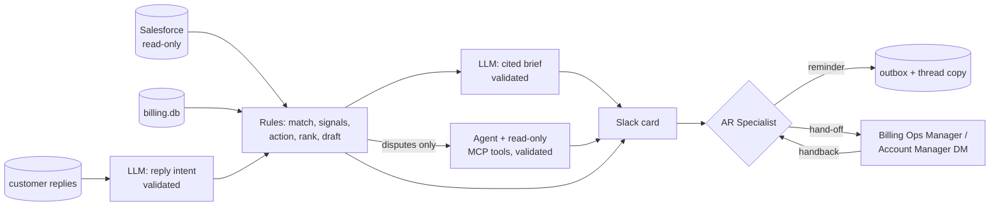

# AR Follow-up Agent (demo)

A prototype that decides each day which overdue customers a finance team should chase and how,
with a person approving every action in Slack.

> Synthetic data and a fictional company (**notacompany**). Built with Claude Code as the coding
> agent under a written protocol (see [How it was built](#how-it-was-built)). Not a production
> system; no real users.

## What it does

Every run reads a Salesforce Developer Edition org, a simulated billing database (SQLite,
standing in for NetSuite) and a simulated inbox of customer replies. It matches customers across
the systems, picks one next action per overdue customer, and posts a card per customer to a
Slack channel. The **AR Specialist** approves, edits, changes or holds each card. Approved
hand-offs go by DM to the **Billing Ops Manager** (disputes, payment checks, escalations) or the
**Account Manager** (renewals, churn), who hand the case back with an outcome.

| Layer | Handles | Why this layer |
|---|---|---|
| Rules (no LLM) | matching, signals, action order, ranking, draft from a template | cheap, testable, predictable |
| LLM steps | reading customer replies; a brief where every sentence cites a record | only text needs a model |
| Agent (read-only MCP) | disputes only: 8 of 58 overdue customers | each dispute needs a different investigation |
| Person in Slack | approve, edit, change action, hold; hand-off and handback | nothing reaches a customer without a person |

Amounts, dates and record IDs in model output must trace back to the source records, or the
output is rejected. No email is ever sent: "send" is a row in an append-only `outbox` table plus
a copy in the Slack thread. Decisions and audit events are append-only.



<!-- TODO screenshot of a Slack card: docs/img/slack-card.png -->

## Example: one dispute

From the 100-customer run (as of 2026-10-15), customer CUS-01052, Marlin Pharmacy Pty Ltd:

1. **Rules:** AUD 793.00 overdue on two invoices, oldest 36 days. A Salesforce case "[Billing]
   Disputed user count on INV-105080" is open, so the action is `pause_and_resolve_dispute`
   (dispute comes first in the playbook order): no reminder goes out.
2. **Reply:** "We're contracted for 14 users but you've billed 19. Please send a corrected
   invoice." The reply is linked to the customer by the invoice number it quotes.
3. **Agent:** 3 rounds of read-only MCP tool calls (customer, invoices, Salesforce cases,
   credit notes, payments, replies, invoice lines, seat comparison), plus 4 calls to the
   `calculate` tool for the arithmetic.
4. **Finding:** INV-105080 bills 19 users at AUD 15.00; the 6 earlier invoices compared bill 14,
   so it is over-billed by AUD 75.00 and no credit note exists. Corrected invoice AUD 359.00.
   Recommendation: `issue_credit_note`. Every finding cites the case, the reply and the invoice.
5. **Validator:** every amount and record ID in the findings appeared in this run's tool
   results, so the investigation is shown on the card as valid.
6. **Slack:** the card goes to the AR Specialist. On approval the Billing Ops Manager receives
   the case by DM and hands it back with an outcome (credit note issued, or dispute rejected).

## Design decisions

- **Use the cheapest layer that can do each job.** Anything structured (amounts, dates, counts,
  record links, the order in which playbook rules apply) is code. A model only reads free text.
  The agent, the most expensive and least testable layer, only gets disputes, with at most
  8 tool rounds and 60,000 tokens per run; hitting a limit routes the case to a person.
- **Read-only by construction.** The runtime Salesforce client refuses writes (tested); only the
  data loader script writes, to demo records. The MCP server opens the databases read-only and
  serves the local snapshot, not Salesforce.
- **Models reason, code counts.** The agent has a `calculate` tool for money in integer cents,
  after an early run invented 10 extra users and 11 invoices in a dispute.
- **Validators prove provenance.** Each output is checked against the records it cites; a
  failure drops the output and the card says why. Each validator is tested both ways: every
  real output must pass and every injected error must fail.
- **Where state lives.** Business facts a person agrees with a customer (a promised payment
  date) belong in the CRM; workflow state (who holds a case, handback outcome, card version)
  stays in the app's own database, append-only.
- **Approval is narrow.** Only the user on record as AR Specialist may decide (no one on record
  = no one may). Approve claims the card atomically and refuses a card whose draft changed after
  it was shown.

## Results

**Action choice.** Same case data and the same playbook text ([PLAYBOOK.md](PLAYBOOK.md), a
simulated AR playbook) for every method; the right answer is what the playbook prescribes.

| Method | My synthetic data (58 cases) | Holdout written by another model (40) |
|---|---|---|
| Rule-based baseline | 57/58 | 25/40 |
| LLM (DeepSeek) | 53/58 | 33/40 |
| Structured classifier, one yes/no per check (TypeSafe Jev) | 52/58 | 32/40 |
| Structured classifier, one 8-way choice (TypeSafe Jev) | 55/58 | 19/40 |

The rules beat the model on my own data and lost on someone else's: the same author wrote the
rules and the test data. Of the 15 rule errors on the holdout, 10 came from misreading reply
text (new dispute wording, "Not paid yet" read as paid, withdrawn cancellations) and 5 from
missing or conflicting fields with no route to a person. Of the 7 DeepSeek errors, 6 were the
wrong priority between two signals. So reading replies moved to the model and the order of
actions stayed in code. Only DeepSeek routed "not enough evidence" cases to a person (5/5).
The combined version has not been scored yet, and the holdout has been studied since, so it
needs a fresh sealed set. Details: [docs/LEARNINGS.md](docs/LEARNINGS.md),
[docs/eval/](docs/eval/2026-10-16-action-eval.md).

**Validators.**

| Check | Result |
|---|---|
| LLM briefs on the 58 overdue customers | 58/58 valid; 316/316 injected errors rejected |
| Agent on the 8 disputes | 8/8 correct; 64/64 injected errors rejected |
| Tests | 33 pytest tests, 8 acceptance scripts; case logic 5/5 mutations caught |
| Live run in Slack | 4 cards handled; 3 hand-offs handed back by their owners |

Injected error types, all designed by me: amount +1.00, date +1 day, a made-up count, an
unknown record ID; for the agent also a real record it never retrieved, a tool name used as a
citation, the wrong disputed invoice and a finding with no citation. 100 % means the validators
stop the error types I thought of. A correctly formatted number copied from another real record
still passes (open, see Limits).

## What I got wrong

- **The validator was too strict.** It rejected 56 of 58 real briefs: it only knew invoice
  fields, read dates inside record IDs (`FU-2026-10-15-…`) and missed that credit notes had no
  currency. Earlier, the same gap left a renewal card whose buttons silently did nothing.
- **Then too loose.** Once real briefs passed, 7 of 316 injected errors got through: written
  dates ("15 October 2026") were never checked, and a planted "47 open disputes" passed because
  "47" appeared inside record IDs. Numbers now have to match whole numbers in the facts.
- **A card showed AUD 218 owed; the truth was 138.** Credit notes were not netted, and the data
  generator used the same logic, so the tests agreed with the bug. Balances are now net of
  credits everywhere, and the acceptance check recomputes them with independent SQL.

The first two happened in the same way twice, so "validators are proven both ways" became a
project rule; it caught the third case (agent tool results parsed wrongly, 5 of 8 real answers
rejected) before the agent's acceptance check was written.

## Limits

- Synthetic data, a Salesforce dev org and a test Slack workspace; no real users.
- Synthetic data goes to DeepSeek, the model key available during development. With real
  customer data only an approved model and region would be used; the model is a config setting
  (`arfollow/llm.py`), and a run with Claude has not been done.
- Validators check that each number exists in the cited records, not that it is used for the
  right thing.
- Not measured: review time per card, cost per case, whether the agent beats the brief alone.
- Not built yet: a Salesforce cross-check of an agreed payment date, stalled-renewal detection,
  a guard against repeat reminders, approval limits by amount.

## How it was built

Claude Code wrote the code; I set the scope, the safety rules and the evaluation, and reviewed
the work. The protocol:

- Agent instructions with safety boundaries and a rule table: [CLAUDE.md](CLAUDE.md).
- A lesson log, [docs/agent/LESSONS.md](docs/agent/LESSONS.md): a mistake becomes a rule only
  after it happens twice.
- An acceptance script per step (`scripts/accept/step_N.py`); `scripts/verify.sh` = done.
- A second model (GPT through the Pi coding agent) as external reviewer
  ([docs/reviews/](docs/reviews/2026-10-16-external-review.md)) and author of the holdout.
- A dev log of which model did what: [docs/DEVLOG.md](docs/DEVLOG.md).

## Targets

| Target | Measured | Status |
|---|---|---|
| Right action ≥ 90 % | rules 57/58 on own data; DeepSeek 33/40 on the holdout | not met on the holdout |
| 100 % for dispute and renewal cases | not broken out | not measured |
| 0 injected wrong amounts / dates reach a person as valid | 316/316 briefs, 64/64 agent | met, for the designed error types |
| Every citation exists in the source | enforced by the validators | met |
| Citations support the claim | — | not measured |
| ≤ 20 % of cases reach the agent | 8/58 = 14 % | met |
| Model cost ≤ US$0.10 per case | — | not measured |
| Review time per card | — | not measured; a shadow run with the team would set the baseline |

## Quick start

Everything runs with [uv](https://docs.astral.sh/uv/) and plain Python 3.13; Claude Code is not
needed. You need your own Salesforce Developer Edition org, your own Slack workspace and a
DeepSeek API key: nothing from the author's setup (tokens, Slack user IDs, `data/`) carries over.
Slack user IDs belong to one workspace, so bind your own people in step 5.

**1. Install**

```bash
git clone <this repo> && cd fde-demo
uv sync                         # creates .venv from uv.lock (Python 3.13)
cp .env.example .env
```

**2. Salesforce (free Developer Edition org)** → `SF_DOMAIN`, `SF_CLIENT_ID`, `SF_CLIENT_SECRET`

1. Sign up at developer.salesforce.com; confirm your user's profile has **API Enabled**.
2. Setup → **External Client App Manager** → New: Distribution State **Local**, enable OAuth,
   callback `https://login.salesforce.com/services/oauth2/success` (unused), scope
   **Manage user data via APIs (api)**, **Enable Client Credentials Flow**.
3. App → Policies → OAuth Policies → **Client Credentials Flow → Run As**: your admin user (the
   loader in step 4 creates and deletes demo records, so the run-as user needs write access;
   the runtime itself only reads, enforced by the client's write guard).
4. App → Settings → **Consumer Key and Secret** → `SF_CLIENT_ID`, `SF_CLIENT_SECRET`.
5. Setup → My Domain → host, e.g. `yourname-dev-ed.develop.my.salesforce.com` → `SF_DOMAIN`
   (`login.salesforce.com` does not work for client credentials).

Check: `uv run python scripts/smoke_salesforce.py` prints the API version and an Account count.
`invalid_grant` = Run As not set; `request not supported on this domain` = wrong domain.

**3. Slack app (Socket Mode)** → `SLACK_BOT_TOKEN`, `SLACK_APP_TOKEN`, `SLACK_CHANNEL_ID`

1. In your workspace create a channel, e.g. `#ar-followup`.
2. api.slack.com/apps → **Create New App → From a manifest** → paste:

   ```yaml
   display_information:
     name: AR Followup
   features:
     app_home: {home_tab_enabled: false, messages_tab_enabled: true,
                messages_tab_read_only_enabled: true}
     bot_user: {display_name: AR Followup, always_online: false}
   oauth_config:
     scopes:
       bot: [chat:write, channels:read, channels:history, users:read, users:read.email]
   settings:
     interactivity: {is_enabled: true}
     socket_mode_enabled: true
   ```

3. Basic Information → **App-Level Tokens** → scope `connections:write` → `SLACK_APP_TOKEN` (`xapp-…`).
4. **Install to Workspace** → Bot User OAuth Token → `SLACK_BOT_TOKEN` (`xoxb-…`).
5. In the channel: `/invite @AR Followup`; channel details → channel ID → `SLACK_CHANNEL_ID`.

Check: `uv run python scripts/smoke_slack.py` posts one message in the channel.

**4. LLM key and demo data**

Put `DEEPSEEK_API_KEY` in `.env` (platform.deepseek.com). Then build the synthetic data and load
it into your org:

```bash
uv run python scripts/generate_data.py --set full   # minimal | small | medium | large | full
uv run python scripts/check_data.py
uv run python scripts/load_db.py                    # billing.json -> data/out/billing.db
uv run python scripts/load_salesforce.py --dry-run  # counts only, touches nothing
uv run python scripts/load_salesforce.py            # writes demo records into YOUR org
```

`load_salesforce.py` is the only code that writes to Salesforce; it touches only demo records
(Accounts with Site = `ardemo` and their children). Use a dev org, never a real one.

**5. Bind your people to roles** (stored in `data/org.db`, created on first use)

```bash
# required: AR Specialist, the user of this tool and the only approver
uv run python scripts/roles.py ar_specialist ar.specialist@yourcompany.com
# optional: Billing Ops Manager, receives disputes, payment checks, escalations
uv run python scripts/roles.py billing_ops_manager billing.ops@yourcompany.com
# optional: Account Manager, receives renewals and churn
uv run python scripts/roles.py account_manager account.manager@yourcompany.com
# list current bindings
uv run python scripts/roles.py
```

Trying it alone: bind all three to yourself, or only `ar_specialist` (hand-offs then come back
to you in the card's thread). Without `ar_specialist` every button is refused (fail closed).

**6. Run**

Terminal 1, keep it running (button listener):

```bash
uv run python -m arfollow.slack_app
```

Terminal 2, once per "day" (refresh data, post the digest and cards):

```bash
uv run python -m arfollow.run --llm --agent --post  # sync, match, LLM intents, rules, briefs, agent, digest
```

Options: `--limit N` cards (default 10); `--offline` reuses the last Salesforce snapshot; drop
`--llm --agent` to run rules only (no LLM key needed). Cards from an older run may be refused
on Approve ("out of date"); use the newest cards.

**Docker (alternative to steps 1 and 6)**

Steps 2-5 (Salesforce, Slack, key, data, roles) are the same; the image only replaces the local
Python install. `.env` is passed in as environment, never copied into the image; `./data` is
mounted, so databases and role bindings stay on the host.

```bash
docker compose up -d --build listener          # button listener, restarts on failure
docker compose run --rm daily                  # one daily run (sync ... post)
docker compose run --rm daily python scripts/roles.py ar_specialist you@yourcompany.com
docker compose run --rm daily python scripts/generate_data.py --set full   # any script
```

Schedule the daily run with the host's cron, e.g.
`0 7 * * * cd /path/to/fde-demo && docker compose run --rm daily`.

**7. Check**

`scripts/verify.sh` runs ruff, pytest and the acceptance steps (step 7 fails on `--set minimal`
by design: it needs every action type).

### Configuration (`.env`)

Copy `.env.example` to `.env` and fill it in; steps 2-4 above show where each value comes from.
`.env` is git-ignored. Code reads values only through `config.require` (fails loudly) or
`config.optional`.

| Variable | Required for | Note |
|---|---|---|
| `SF_DOMAIN` | sync, load | My Domain host, e.g. `yourname-dev-ed.develop.my.salesforce.com` |
| `SF_CLIENT_ID`, `SF_CLIENT_SECRET` | sync, load | External Client App, client credentials flow |
| `SF_API_VERSION` | — | optional; default is the latest the org offers |
| `SLACK_BOT_TOKEN` | `--post`, listener, roles | `xoxb-…`; scopes `chat:write`, `channels:read`, `channels:history`; `users:read` and `users:read.email` for `roles.py` |
| `SLACK_APP_TOKEN` | listener | `xapp-…`, Socket Mode app-level token |
| `SLACK_CHANNEL_ID` | `--post` | review channel, e.g. `#ar-followup` |
| `DEEPSEEK_API_KEY` | `--llm`, `--agent` | OpenAI-compatible endpoint; model per task in `arfollow/llm.py` |
| `TYPESAFE_API_KEY` | `eval_actions.py` only | the Jev eval arm; not used at runtime |

Without `--llm`/`--agent` no LLM key is needed; `--offline` reuses the last snapshot and needs
no Salesforce credentials.

### Roles: binding Slack users

The tool is built for the **AR Specialist**: they get the daily digest and every card, and they
alone decide. The other two roles only receive hand-offs the AR Specialist approves (a DM with
the case) and hand the case back with an outcome. Who holds each role lives in `data/org.db`
(kept across data resets), not in `.env`:

| Role key | Job title | Duties in this workflow |
|---|---|---|
| `ar_specialist` | AR Specialist (the user of this tool) | reviews every card; the only one who may press Approve / Edit / Change / Hold (unset = nobody can); sends standard and gentle reminders; owns each case before a hand-off and after the handback |
| `billing_ops_manager` | Billing Ops Manager | disputes (invoice lines, contract, credit notes), payment verification and cash application, chronic-late escalations (call, payment plan, suspension) |
| `account_manager` | Account Manager | renewals in progress, churn and retention; agrees commercial concessions |

```bash
uv run python scripts/roles.py                                # list current bindings
uv run python scripts/roles.py ar_specialist you@example.com  # bind by Slack email
uv run python scripts/roles.py billing_ops_manager U0123ABCD           # or by Slack user ID
uv run python scripts/roles.py account_manager --clear        # unset: hand-off goes to the approver
```

The person must be a member of your Slack workspace; IDs from another workspace do not work.
Lookup by email needs the `users:read.email` scope. A Slack user ID is in the person's
profile → ⋯ → Copy member ID.

## How a run works

One command, `uv run python -m arfollow.run --llm --agent --post`, runs these steps in order:

| # | Step | Code | Reads | Writes |
|---|---|---|---|---|
| 1 | Snapshot Salesforce (SOQL, read-only) | `sync.sync_salesforce` | Salesforce Account, Contact, Opportunity, Case, Task | `app.db` `sf_records` |
| 2 | Match billing customers to accounts (account number, name, domain vote) | `sync.match_customers` | `billing.db` customers, `sf_records` | `matches` |
| 3 | Link customer replies (invoice ID → contact email → billing email → signature) | `rules.link_messages` | `data/out/inbox.json` | `messages` |
| 4 | LLM: classify each reply's intent, validated (`--llm`) | `llm_steps.classify_replies` | `messages` | `reply_labels`, `llm_calls` |
| 5 | Close cases whose customer is no longer overdue | `review.close_settled_cases` | `cases`, invoices | `cases` |
| 6 | Rules: signals → action (first match wins) → template draft | `rules.build_followups`, `save_followups` | billing, snapshot, replies, `PLAYBOOK.md` order | `followups` |
| 7 | LLM: cited brief per follow-up, validated (`--llm`) | `llm_steps.write_briefs` | the follow-up's evidence records | `briefs` |
| 8 | Agent: investigate disputes only, via the MCP server (`--agent`) | `agent.run_disputes` | 9 read-only MCP tools + `calculate` | `agent_runs` |
| 9 | Post digest + one card per follow-up to Slack (`--post`) | `slack_app.post_digest` | `followups`, briefs, agent runs | Slack, `followups.slack_ts` |

Action order (first match wins): dispute → payment claimed → renewal → churn → chronic late →
expired card → standard reminder. A failed validator never reaches a person as "valid": the
output is dropped and the card says why.

On each card the AR Specialist (`ar_specialist`, the only user allowed to decide) can:

| Button | Effect |
|---|---|
| Approve | Re-checks the card version and every amount/date; writes a decision, an `outbox` row (never a real email), a copy in the thread, and a DM to the role that owns the action |
| Edit | Opens the draft; the edited text must pass the same amount/date check |
| Change action | Pick another action with a reason; logged as an override |
| Hold | Pause the follow-up, no message |
| Handback (in the owner's DM) | The owner (Billing Ops Manager or Account Manager) closes the hand-off with an outcome, e.g. an agreed payment date; the customer is not re-carded until that date or new evidence |

Every press writes append-only `decisions` and `audit_log` rows in `app.db`.

## MCP and Claude Code tooling

**MCP used by the product.** One server, written for this project: `arfollow/mcp_server.py`
(`arfollow-readonly`, Python `mcp` SDK, stdio). `agent.py` starts it as a subprocess; it opens
`app.db` / `billing.db` read-only (`mode=ro`) and serves the local snapshot, never calling
Salesforce. Tools: `get_customer`, `list_invoices`, `get_invoice_lines`, `compare_seats`,
`list_payments`, `list_credit_notes`, `list_crm_cases`, `list_crm_activities`, `list_replies`.
The agent also has a local `calculate` tool (exact integer-cent arithmetic). No third-party MCP
server (e.g. the official Salesforce one) is used.

**Claude Code (development only).** The code was written with Claude Code; none of the
following is needed to run it:

| Item | Path | Purpose |
|---|---|---|
| Project instructions | `CLAUDE.md` | safety boundaries, autonomy, rule table |
| Skill | `.claude/skills/promote` | promote a lesson seen twice in LESSONS.md into a rule (asks first) |
| Path rules | `.claude/rules/` (python, salesforce, synthetic-data) | conventions loaded for matching files |
| Hook | `.claude/hooks/block-env.sh` | blocks shell commands that touch `.env` |
| Settings | `.claude/settings.json` | deny reading `.env`, deny force push, ask before `load_salesforce.py` |

No MCP server is configured for Claude Code in this repo.

## Repo map

```
arfollow/                  runtime package (plain Python, no Claude needed)
  config.py                loads .env; require() / optional(); paths of the three databases
  salesforce.py            REST client, OAuth client credentials, write guard (read-only)
  store.py                 SQLite connections: billing.db (read-only), app.db, org.db
  sync.py                  steps 1-2: Salesforce snapshot, entity matching
  rules.py                 layer 1: link replies, signals, action, ranking, draft templates
  llm.py                   one stateless JSON chat call; provider and model per task
  llm_steps.py             layer 2: reply classification, cited briefs, their validators
  mcp_server.py            read-only MCP server (stdio) the agent investigates with
  agent.py                 layer 3: dispute agent, step/token caps, validate_investigation
  review.py                decisions: authorize, approve/edit/override/hold, cases, handback
  slack_app.py             digest, cards, button listener (Socket Mode)
  run.py                   the daily pipeline above
db/billing.sql             simulated NetSuite schema (money in INTEGER cents)
db/app.sql                 system store: snapshot, matches, follow-ups, decisions, outbox, audit
db/org.sql                 roles table (who holds which role)
scripts/
  generate_data.py         deterministic synthetic data -> data/out/ (--set minimal..full)
  check_data.py            sanity check of the generated data
  load_db.py               billing.json -> data/out/billing.db
  load_salesforce.py       salesforce.json -> Salesforce dev org (the only writer; --dry-run)
  roles.py                 bind Slack users to roles in data/org.db
  smoke_salesforce.py      Salesforce connectivity check
  smoke_slack.py           Slack connectivity check (posts one message)
  clear_slack.py           delete this bot's messages in the channel
  eval_actions.py          action eval: rules vs DeepSeek vs Jev on the generated set and holdout
  accept/step_N.py         per-step acceptance check (exit 0 = pass)
  verify.sh                lint + tests + acceptance = definition of done
tests/                     pytest (approve auth/race, cases, MCP read-only, no email, ...)
PLAYBOOK.md                the (simulated) AR playbook: actions and the order they are checked
Dockerfile, compose.yaml   optional container run: listener service + one-shot daily job
data/                      local only, not in git: billing.db, app.db, org.db, out/, eval/
docs/                      ONTOLOGY (objects, roles, actions), LEARNINGS (trade-offs), SETUP,
                           DEVLOG, agent/LESSONS, eval/ and reviews/ reports
```
